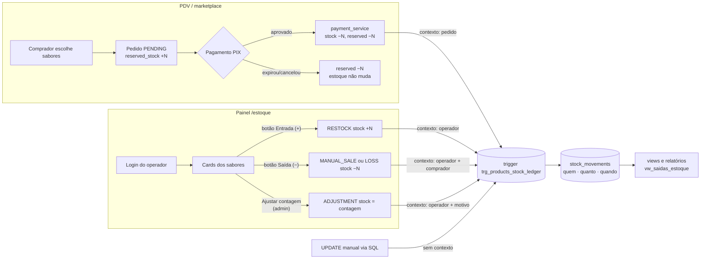

# Plano de ação — Controle de estoque do marketplace Red Bull (CITi)

**Base:** branch `main` do `FKomata/redbull_compra_citi` (commit `0feecef`, head Alembic `7e03d1bf5a42`).
**Entrega:** revisão Alembic `c3f8a1d27b54`, painel `/estoque`, scripts SQL e testes.

## 1. Situação

- O código do controle de estoque foi perdido. O marketplace (PDV) continua funcionando, mas depende de `products.stock` e `products.reserved_stock`, e hoje não há ferramenta para repor latas, registrar vendas fora do PIX ou auditar saídas.
- Sem ferramenta, a única forma de mexer no estoque seria `UPDATE` manual, o que o próprio projeto proíbe e que não deixa rastro.
- O banco institucional ainda tem as tabelas `users` e `stock_adjustments`, que provavelmente vieram do sistema perdido. Elas **não são alteradas** por esta entrega.

## 2. Objetivo e critérios de pronto

| # | Critério | Como é atendido |
|---|----------|-----------------|
| 1 | Banco registra **quem comprou, quantas latas saíram e o horário** | Tabela `stock_movements` + trigger `trg_products_stock_ledger` |
| 2 | Vendas do marketplace entram no registro sem trabalho manual | `payment_service` informa o pedido ao trigger na mesma transação do pagamento |
| 3 | Plataforma visual com **todos os sabores** do marketplace | Painel `/estoque` lista `products` com as mesmas imagens do PDV |
| 4 | Botões **adicionar (+)** e **decrementar (−)** que alteram o banco | `POST /api/estoque/movimentos` com lock de linha e validação |
| 5 | **Tela de login** | `staff_users` + `staff_sessions`, senha com scrypt, cookie HttpOnly |
| 6 | Não quebrar o PDV nem o histórico do banco institucional | 113 testes passando (85 da main + 28 novos); `alembic check` sem diferenças |

## 3. Fluxo da solução

Pontos-chave:

1. **Reserva não é saída.** Quando o comprador gera o PIX, só `reserved_stock` sobe. A saída acontece quando o pagamento é aprovado; é nesse momento que a linha `MARKETPLACE_SALE` é gravada com nome, e-mail, pedido e preço unitário.
2. **O banco é a fonte da verdade do histórico.** A aplicação só diz *quem/por quê* via `set_config('redbull.stock_context', …, true)`; o trigger grava a linha. Qualquer caminho que mude `products.stock` (webhook, reconciliação, painel, SQL manual) fica registrado.
3. **O trigger nunca bloqueia uma venda.** Se o contexto vier inválido ou incoerente, a linha é gravada como `UNTRACKED` com uma observação, em vez de abortar o pagamento. A função é `SECURITY DEFINER` (com `search_path` fixo), então funciona mesmo se a role da aplicação não tiver permissão direta em `stock_movements`.
4. **O painel não mexe em latas reservadas.** Uma saída manual não pode deixar `stock < reserved_stock`, então quem está pagando um PIX nunca perde a lata.
5. **O painel nunca altera estoque sem registro.** Depois de mudar o estoque, o painel confere a linha que o trigger gravou; se ela não existir ou não bater, a transação inteira é desfeita.

## 4. Modelo de dados

### `stock_movements` — livro-razão (uma linha por alteração de estoque)

| Coluna | Para quê |
|--------|----------|
| `created_at` | **horário da saída/entrada** (timestamptz; views mostram em America/Recife) |
| `product_id`, `product_name` | sabor (nome congelado no momento) |
| `movement_type` | `MARKETPLACE_SALE`, `MANUAL_SALE`, `LOSS`, `RESTOCK`, `ADJUSTMENT`, `INITIAL_STOCK`, `UNTRACKED` |
| `source` | `MARKETPLACE`, `PAINEL` ou `BANCO` |
| `quantity`, `delta` | **quantas latas** (absoluto e com sinal) |
| `stock_before`, `stock_after`, `reserved_stock_after` | saldo antes/depois, para conferência |
| `buyer_name`, `buyer_email` | **quem comprou** (do pedido ou digitado no painel) |
| `order_id`, `unit_price` | pedido do marketplace e preço pago |
| `staff_user_id` | operador que lançou no painel |
| `note`, `db_user` | observação e usuário do banco que executou |

Restrições garantem coerência: `stock_after = stock_before + delta`, venda/perda sempre negativa, reposição sempre positiva, venda manual sempre com comprador.

Nos totais do dia (painel e relatórios), **saídas** = vendas no marketplace + vendas manuais + perdas; **entradas** = reposições. Ajustes de inventário aparecem no histórico, mas não entram nesses totais.

### `staff_users` e `staff_sessions` — login do painel

- `staff_users`: `username` (único, minúsculo), `full_name`, `password_hash` (scrypt com salt), `role` (`ADMIN` ou `OPERADOR`), `active`, bloqueio por tentativas.
- `staff_sessions`: guarda só o SHA-256 do token do cookie, com expiração (12 h padrão) e revogação no logout.

### Views

- `vw_estoque_atual` — estoque físico, reservado e disponível por sabor.
- `vw_movimentacoes_estoque` — histórico completo em português, com operador e horário local.
- `vw_saidas_estoque` — só as saídas (o relatório "quem comprou, quanto, quando").

## 5. Operação do dia a dia

| Situação | Quem | Onde | Resultado no banco |
|----------|------|------|--------------------|
| Chegaram latas | Operador | Card do sabor → **+ Entrada** | `RESTOCK` com operador e observação |
| Alguém comprou em dinheiro/fora do PIX | Operador | **− Saída** → *Venda* (nome obrigatório) | `MANUAL_SALE` com comprador |
| Lata amassada, vencida, sumiu | Operador | **− Saída** → *Perda* | `LOSS` com observação |
| Contagem física diferente do sistema | Admin | **Ajustar contagem** (motivo obrigatório) | `ADJUSTMENT` com o delta |
| Compra pelo QR Code | Ninguém | automático | `MARKETPLACE_SALE` com nome, e-mail, pedido e preço |
| Fechamento do dia/mês | Admin | `sql/consultas_estoque.sql` | relatórios prontos |

Recomendação: contagem física semanal pelo admin, e conferir a consulta 8 (`UNTRACKED`) e a consulta 9 (integridade) do arquivo de relatórios.

## 6. Plano de implantação

### Fase 0 — Preparar (dev, ~1 h)

- [ ] Aplicar o patch numa branch nova a partir da `main` (`git am entrega_estoque/0001-*.patch`).
- [ ] `pip install -r requirements.txt` (nenhuma dependência nova).
- [ ] `docker compose up -d postgres_test && pytest` → esperado **113 passed**.

### Fase 1 — Homologar numa cópia do banco institucional (~1 h)

- [ ] Restaurar um backup recente do banco institucional num banco de teste.
- [ ] `alembic current` → deve ser `7e03d1bf5a42` (se não for, **parar** e aplicar antes as revisões pendentes da main).
- [ ] `alembic upgrade head` → `c3f8a1d27b54`.
- [ ] Conferir que `users` e `stock_adjustments` continuam com as mesmas linhas (consulta 10 de `sql/consultas_estoque.sql`).
- [ ] `alembic downgrade -1` e `alembic upgrade head` de novo (precisa funcionar ida e volta).
- [ ] Rodar `sql/seed_sabores.sql` e conferir se nenhum sabor duplicou (o script pula ids e nomes já existentes).
- [ ] Criar um admin, entrar em `/estoque`, lançar uma entrada, uma saída e fazer uma compra mock.

### Fase 2 — Produção (janela curta, ~30 min)

- [ ] Confirmar backup/ponto de restauração do banco institucional.
- [ ] Configurar no Render: `STOCK_SESSION_COOKIE_SECURE=true` (já é o padrão) e, se quiser, `STOCK_SESSION_TTL_HOURS`.
- [ ] `alembic upgrade head` no banco institucional (com autorização explícita).
- [ ] Rodar `sql/seed_sabores.sql` **somente se** faltarem sabores no PDV.
- [ ] Deploy do backend/frontend.
- [ ] `python -m scripts.create_staff_user --username … --name "…" --role ADMIN` para cada admin; `--role OPERADOR` para os demais.

### Fase 3 — Carga inicial e validação (~30 min)

- [ ] Contar as latas físicas e lançar via **Ajustar contagem** (ou **+ Entrada** se o estoque estiver zerado), com motivo "Inventário inicial".
- [ ] Fazer uma compra real de 1 lata pelo QR Code e conferir no painel: a linha `Marketplace` aparece com o nome do comprador e o horário.
- [ ] Rodar a consulta 9 (integridade): resultado esperado `diferenca = 0` em todos os sabores.

### Rollback

`alembic downgrade -1` remove apenas as tabelas, trigger e views novas (**apaga o histórico de movimentações e os operadores**). O PDV continua funcionando como antes. Exporte `vw_movimentacoes_estoque` antes, se quiser guardar o histórico.

## 7. Riscos e mitigação

| Risco | Mitigação |
|-------|-----------|
| Banco institucional fora da head esperada | Checklist da Fase 1 para antes de qualquer `upgrade`; nunca usar `alembic stamp head` |
| Duplicar sabor ao rodar o seed | Seed compara id **e** nome normalizado; insere com estoque 0 |
| Operador tirar lata que está reservada num PIX | Validação no servidor: `stock` nunca fica abaixo de `reserved_stock` |
| Dois operadores mexendo no mesmo sabor | `SELECT … FOR UPDATE` no produto (teste de concorrência incluso) |
| Correção manual por SQL sem rastro | Trigger grava `UNTRACKED` com `db_user`; consulta 8 lista essas linhas |
| Senha vazada ou força bruta | scrypt (fora do event loop) + bloqueio da conta após 5 erros por 15 min + limite de 20 falhas por IP a cada 10 min; cookie HttpOnly/SameSite=Strict/Secure; cabeçalho anti-CSRF; CSP na página |
| Operador saiu do CITi | `create_staff_user --deactivate` revoga as sessões na hora |

## 8. Próximos passos sugeridos (backlog)

1. Tela de administração de operadores no próprio painel (hoje é pela CLI).
2. Exportar CSV das saídas por período direto do painel.
3. Alerta (e-mail/Slack) quando um sabor ficar com estoque baixo.
4. Decidir se vale importar o histórico de `stock_adjustments` para `stock_movements` (consulta 10 mostra a estrutura).
5. Restringir no Postgres: o usuário da aplicação sem `UPDATE`/`DELETE` em `stock_movements` (livro-razão somente inserção).

## 9. Arquivos

| Arquivo | Conteúdo |
|---------|----------|
| `app/db/migrations/versions/c3f8a1d27b54_add_stock_control_ledger.py` | Migration: tabelas, trigger e views |
| `sql/estoque_schema.sql` | Mesmo modelo em SQL puro (idempotente) |
| `sql/seed_sabores.sql` | Catálogo dos 12 sabores (opcional, seguro) |
| `sql/consultas_estoque.sql` | Relatórios: saídas do dia, quem comprou, ranking, integridade |
| `app/stock_service.py` | Regras de estoque e contexto do livro-razão |
| `app/staff_auth.py` | Login, sessões, hash de senha, CSRF, bloqueio |
| `app/stock_panel.py` | Rotas `/estoque` e `/api/estoque/*` |
| `app/static/estoque/` | CSS e JS do painel (sem build) |
| `scripts/create_staff_user.py` | CLI para criar/desativar operadores |
| `tests/test_stock_panel.py`, `tests/test_stock_schema_sql.py` | 28 testes novos (login, permissões, concorrência, marketplace, trigger) |
| `scripts/export_stock_schema_sql.py` | Regera `sql/estoque_schema.sql` a partir da migration |
| `app/templates/estoque.html` | Página do painel (servida só em `/estoque`, com CSP) |
| Alterados: `app/db/models.py`, `app/models.py`, `app/main.py`, `app/payment_service.py`, `app/store.py`, `tests/test_migrations.py`, `README.md`, `.env.example` | Integração com o que já existe |

### API do painel

| Método | Rota | Uso |
|--------|------|-----|
| `POST` | `/api/estoque/login` | entrar (define o cookie) |
| `POST` | `/api/estoque/logout` | sair (revoga a sessão) |
| `GET` | `/api/estoque/me` | operador logado |
| `GET` | `/api/estoque/produtos` | sabores com estoque físico, reservado, disponível e saídas do dia |
| `POST` | `/api/estoque/movimentos` | lançar entrada, saída, perda ou ajuste |
| `GET` | `/api/estoque/movimentos` | histórico (`direction=in/out`, `product_id`, paginação por `before_id`) |
| `GET` | `/api/estoque/resumo` | totais do dia |

Rotas `POST` exigem o cabeçalho `X-Requested-With: estoque-panel`.
